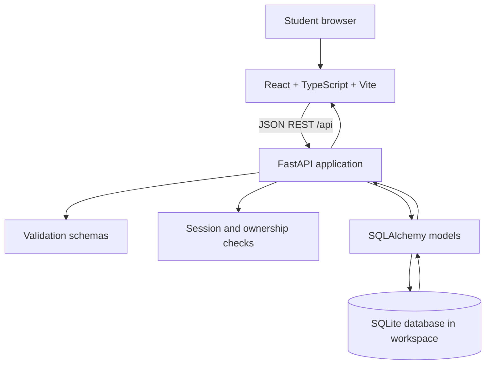
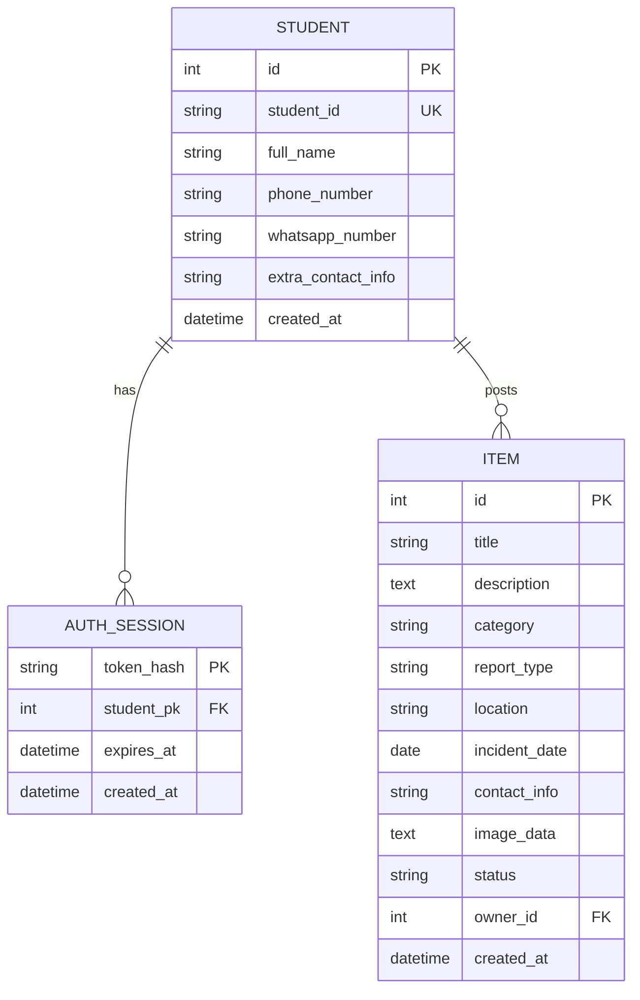

# Technical Design Document (TDD)

**System:** IUB Lost & Found  
**Version:** 1.1  
**Course:** CSE309

## 1. Design overview

The application uses a small three-layer design: React UI components, a JSON REST API, and a relational data store. The intention is to keep the MVP easy to explain and demonstrate while leaving a clear path toward the Beta release.



### Release allocation

- **MVP:** React + TypeScript, FastAPI + Python, Vite proxy, SQLite, demo sessions, CRUD REST API, public browse/search, contact endpoint, owner restrictions, documentation.
- **Beta:** IUB SSO, Student/Moderator RBAC, profile dashboard, granular scopes, moderation, managed PostgreSQL, production deployment, secure image storage, monitoring and backups.

## 2. Repository layout

```text
IUB-Lost-and-Found/
├── .devcontainer/
│   └── devcontainer.json
├── backend/
│   ├── app/
│   │   ├── __init__.py
│   │   ├── database.py
│   │   ├── main.py
│   │   ├── models.py
│   │   └── schemas.py
│   ├── tests/
│   │   └── test_api.py
│   ├── requirements.txt
│   └── .env.example
├── docs/
│   ├── PRD.md
│   ├── SRS.md
│   └── TDD.md
├── frontend/
│   ├── public/
│   ├── src/
│   │   ├── api.ts
│   │   ├── App.tsx
│   │   ├── main.tsx
│   │   ├── styles.css
│   │   └── types.ts
│   ├── index.html
│   ├── package.json
│   ├── tsconfig.json
│   └── vite.config.ts
├── .gitignore
└── README.md
```

## 3. Frontend design

### 3.1 Stack

- React 18 with TypeScript.
- Vite for development server and production build.
- Lucide React for consistent icons.
- Plain modular CSS with responsive breakpoints to keep the demo setup small.

### 3.2 Main UI areas

1. University identity bar and sticky navigation.
2. Hero, search input, and popular search shortcuts.
3. Aggregate board metrics.
4. Reports board with type/category/status filters.
5. Report cards with privacy-aware contact action and owner-only actions.
6. New report form, demo sign-in dialog, and contact dialog.
7. “How it works” instructions, safety reminder, and footer disclaimer.

### 3.3 State and API integration

- The bearer token is stored in browser local storage for this demonstration.
- An initial `/api/auth/me` request restores a demo session when a token is present.
- Search and filters trigger a board list request.
- Create, resolve, and delete actions refresh board data and summary counts.
- API failures are shown as an error panel, form error, or toast rather than silently ignored.

## 4. Backend design

### 4.1 Stack

- FastAPI exposes the REST API and interactive OpenAPI page at `/docs`.
- Pydantic schemas validate incoming request data.
- SQLAlchemy maps application records to relational tables.
- SQLite is the default database, stored at `backend/data/lost_found.db` when the backend is launched from its folder.
- Uvicorn runs the application.

### 4.2 Request lifecycle

1. Browser sends a request to `/api/...`.
2. During development, Vite forwards the path to FastAPI on port 8000.
3. FastAPI validates request values with Pydantic.
4. Protected routes validate the bearer session and enforce ownership.
5. SQLAlchemy reads or writes rows.
6. FastAPI returns a typed JSON response or an appropriate HTTP error.

### 4.3 Authentication/session design — MVP limitation

The login endpoint normalizes the Student ID, display name, and contact numbers; it stores the required phone number plus optional WhatsApp and extra contact information, creates a student row if necessary, and issues a random bearer token. The database stores only the token's SHA-256 hash and a seven-day expiration time. Sign-out deletes that session record.

**This is a classroom demo mechanism, not authentication of a real IUB identity.** Because the demo accepts a Student ID and name without a password or university verification, a user could impersonate another student. Before real use, replace this flow with IUB-approved SSO or another verified identity provider and establish identity fields from that provider only.

### 4.4 Contact privacy

`GET /api/items` intentionally leaves `contact_info` null. Signed-in students request contact instructions via `GET /api/items/{id}/contact`. A production release should additionally apply abuse reporting, access logging, data retention, and moderation policies.

## 5. Database design



### 5.1 Relationships

- One Student can have multiple sessions.
- One Student can publish multiple Items.
- Deleting a student row cascades to the student's sessions and reports. There is no public endpoint for deleting a student in the MVP.

### 5.2 Important indexes

Student ID is unique and indexed. Item type, category, status, owner, location, title, and created timestamp are indexed for common filters and ordering. `ix_items_board_order` supports the status/newest-first board path. For a large-scale product, review the query plan and full-text-search needs before adding more indexes.

## 6. REST API design

Base prefix: `/api`

| Method + path | Access | Request / response summary |
|---|---|---|
| `GET /health` | Public | Service status. |
| `POST /auth/login` | Public | `{ student_id, full_name, phone_number, whatsapp_number?, extra_contact_info? }` → `{ access_token, token_type, user }`. |
| `GET /auth/me` | Bearer session | Current public student profile. |
| `POST /auth/logout` | Token-aware | Invalidates the supplied session; returns 204. |
| `GET /stats` | Public | Total/open/resolved/lost/found counts. |
| `GET /items` | Public | Optional `q`, `category`, `report_type`, `status`; returns at most 100 newest reports. Contact instructions are omitted. |
| `POST /items` | Bearer session | Validated report body → created report, HTTP 201. |
| `GET /items/{id}/contact` | Bearer session | Reporter name, phone, WhatsApp, optional profile notes, and report-specific instructions. |
| `GET /items/{id}/image` | Public | Serves the attached photo bytes, if present. |
| `PATCH /items/{id}/status` | Owner only | `{ status: "open" | "resolved" }` → updated report. |
| `DELETE /items/{id}` | Owner only | Deletes the report, HTTP 204. |

### 6.1 Item category values

`Electronics`, `Cards & IDs`, `Bags`, `Clothing`, `Books`, `Keys`, `Accessories`, `Other`.

### 6.2 Error conventions

- 401 — missing/invalid demo session for a protected action.
- 403 — valid session, but the user is not the report owner.
- 404 — item/report does not exist.
- 422 — invalid or incomplete payload/query.
- 500 — unexpected server issue; sensitive internals should not be exposed in production.

## 7. Configuration and deployment

### 7.1 Environment variables

| Variable | Default | Meaning |
|---|---|---|
| `DATABASE_URL` | `sqlite:///./data/lost_found.db` | SQLAlchemy connection URL. |
| `CORS_ORIGINS` | `http://localhost:5173,http://127.0.0.1:5173` | Comma-separated frontend origins allowed by CORS. |

Launch the backend from the `backend/` directory so the default SQLite path resolves to `backend/data/lost_found.db`. The devcontainer forwards ports 5173 and 8000.

### 7.2 Codespaces persistence note

Codespaces is the development environment, not a database product. The default SQLite file is created in the workspace. It generally remains available while the workspace storage is retained, but it is not a managed database and should not be treated as a production backup. A deployed multi-user Beta should use a managed database such as PostgreSQL and configure secrets outside source control.

### 7.3 Future deployment plan — Beta

- Frontend hosted on an approved static web host.
- FastAPI hosted on a managed application service.
- Managed PostgreSQL database with migration management and backups.
- HTTPS, restricted CORS origins, secret management, logging, monitoring, and rate limiting.
- IUB-approved authentication and moderation/access-control policies.

## 8. Test strategy

- **Backend smoke tests:** health endpoint, public report list, login plus `/auth/me`.
- **Build check:** `npm run build` must complete without TypeScript errors.
- **Manual acceptance:** guest search, sign in, create report, contact instructions, resolve, delete.
- **Authorization:** try mutating a report with a different student's token and check for 403.
- **Data privacy:** verify guest list responses do not contain contact instructions.
- **Beta gate:** do not accept actual student identity data until verified authentication, approved hosting, and a privacy review exist.

## 9. Technical trade-offs

- SQLite reduces setup and makes the demo self-contained, but is not intended for concurrent production workloads.
- Demo sign-in demonstrates session handling and protected endpoints but does not authenticate a real person.
- Contact instructions are free text for simplicity; a production app should avoid exposing personal phone numbers by default and provide safer mediated contact.
- Reports use illustrative seed data; it is not an official inventory or real IUB lost-property feed.


## Contact profile and item photo storage

The `students` table stores `phone_number`, optional `whatsapp_number`, and optional `extra_contact_info`. Startup includes a small schema migration so an existing Codespaces SQLite database gains these columns without deleting existing reports. The `items` table stores optional `image_data` as a data URL; the UI restricts uploads to JPG/PNG/WebP files of 2 MB or smaller and the API validates the MIME prefix and decoded size. Board responses return only an `image_url`; `GET /api/items/{id}/image` decodes and serves the photo so image data is not copied into every board JSON response. Contact fields remain behind the authenticated `/api/items/{id}/contact` route. For production, migrate photos to object storage and serve them via managed URLs rather than keeping base64 image data in SQLite.


## Authorization enforcement

The React interface routes post actions through student sign-in and resumes the posting flow after successful sign-in. Authorization is also enforced server-side: `POST /api/items` depends on `get_current_user`, so hiding UI controls is not the only protection. API tests verify that unauthenticated report creation receives `401 Unauthorized`.
